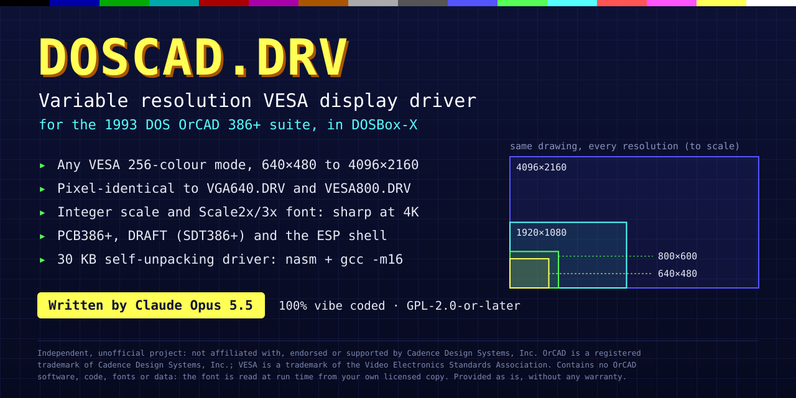

<!--
SPDX-FileCopyrightText: 2026 Joaquim Serra
SPDX-License-Identifier: GPL-2.0-or-later
-->

<p align="center"></p>

# DOSCAD.DRV — variable resolution advanced VESA driver for OrCAD 386+

*Developed by Claude Opus 5.5 in high effort mode.*

## Download

**[Download the latest package from the Releases page](https://github.com/jserra71/doscad-drv/releases/latest)**:
`doscad.drv.<version>.zip`, with the ready-to-use `DOSCAD.DRV`, the sources and this
document, and `doscad.drv.<version>.zip.sha256` to check it
(`sha256sum -c doscad.drv.<version>.zip.sha256`).

GitHub's green **Code → Download ZIP** button and the *Source code* archives of each
release hold the sources only, without `DOSCAD.DRV`: use them only to build the driver
yourself (section 6).

> **Disclaimer.** This is an independent, unofficial project. It is not affiliated with,
> endorsed, sponsored or supported by Cadence Design Systems, Inc., the former OrCAD, Inc.,
> or any other company named here.
>
> - OrCAD is a registered trademark of Cadence Design Systems, Inc. VESA is a trademark of
>   the Video Electronics Standards Association. IBM, MS-DOS and Windows are trademarks of
>   their respective owners. All other names are the property of their owners. They are
>   used here only to say what this driver works with.
> - This package contains no OrCAD software, code, fonts or other data. The driver reads
>   the font from the user's own copy of `VGA640.DRV` at run time and never copies or
>   distributes it.
> - Running OrCAD with this driver requires a copy of OrCAD that you are licensed to use.
>   This package grants no rights to any OrCAD software.
> - The driver exists so that the OrCAD 386+ programs can keep working on today's emulated hardware
>   (interoperability). It does not change, patch or include the original programs.
> - It is provided "as is", without any warranty (see the licence at the end). Use it at
>   your own risk.

DOSCAD.DRV is a display driver for the 1993 DOS OrCAD 386+ suite (PCB386+, SDT386+ and the
ESP shell, run under DOSBox-X); it is tested with ESP, DRAFT and PCB386.
It replaces `VGA640.DRV` / `VESA800.DRV` / `VESA1024.DRV` and draws through any VESA 256-colour
mode the emulated card has, from 640×480 up to 4096×2160, with the same 16 colours and the
same 8×8 font as the original drivers (read at start-up from your own `VGA640.DRV`). Above 1080 lines it enlarges the whole picture by an
integer scale and smooths the font (Scale2x / Scale3x), so the text stays readable at 4K.

At 640×480 and 800×600 the PCB386 board picture is pixel-identical to `VGA640.DRV` and
`VESA800.DRV`; so are DRAFT's, zoomed out too, and ESP's. ESP fills the whole screen at any resolution.

Package version: **1.7.1**; driver version: **1.7.1** (see the changelog at the end). The
start screen of PCB386 shows
`Variable resolution advanced VESA driver  v1.7.1  1920x1080 256 colours` with the mode that
was actually set.

### Package files

The package `doscad.drv.<version>.zip` (with its `.sha256` checksum) holds:

| File | What it is |
| --- | --- |
| `DOSCAD.DRV` | The driver, ready to use: the only file you need to install (section 1). |
| `README.md` | This document. |
| `COPYING` | The licence: GNU General Public License, version 2 (the driver is GPL-2.0-or-later). |
| `banner.svg` | The picture at the top of this document. |
| `build.sh` | Builds `DOSCAD.DRV` from the sources below (section 6). |
| `stub.asm` | Loader stub, the part of the file DOS loads: unpacks the driver image into a memory block that stays resident and is shared by every program (upper memory when there is room), and hands control to it. |
| `doscad.asm` | Real-mode part of the driver image: load routine, entry table and the thunks from each PCB386 driver entry into the C code. |
| `doscad.c` | Drawing code: the PCB386 display driver entries on a VESA 256-colour mode, the font loader, the scaling and the frame rate overlay. |
| `link.ld` | Linker script: lays out the flat 16-bit driver image (assembly first, then the C code and data). |
| `lzpack.py` | Compresses the driver image so that `DOSCAD.DRV` stays small; `stub.asm` unpacks it. |

The sources are only needed to rebuild the driver. `DOSCAD.DRV` unpacks itself in memory
when it loads, which some antivirus programs report as suspicious; the sources and
`build.sh` let you build the same file yourself.

## 1. Install

1. Unzip the package (see Download at the top) and copy `DOSCAD.DRV` into the OrCAD
   driver directory, next to `VGA640.DRV`. With the folders of section 2 (`~/orcad`
   mounted as `C:`) that is `~/orcad/orcadesp/drv/`, `C:\ORCADESP\DRV\DOSCAD.DRV` inside
   DOSBox-X.
   `VGA640.DRV` must stay there: the 8×8 font belongs to OrCAD, so it is not in this
   package, and the driver reads it from `VGA640.DRV` when PCB386 starts (see
   `DOSCADFONT` in section 3 for another place).
2. Select it, either:
   - with the `ORCADDD` variable (in the DOSBox-X `[autoexec]`, before PCB386 starts):
     `set orcaddd=c:\orcadesp\drv\doscad.drv`; or
   - in the project's `PCB.CFG`: `DD = 'DOSCAD.DRV'` (PCB386 reads `PCB.CFG` only when the
     project has no `PCB.BCF`).
   - In the ESP launcher, set the driver to `DOSCAD.DRV` in every ESP section and in
     every project that names its own driver (e.g. one set up for `svga_et4000`). ESP
     itself reads `DD` in the project's `ESP.CFG`: set it to `DOSCAD.DRV` too
     (`DD = 'DOSCAD.DRV'`), so ESP also has the idle halt (section 5) and fills the
     screen. Use the same file name everywhere (section 4).
   - DRAFT reads `DD` in the project's `SDT.CFG`: set it to `DOSCAD.DRV` there, with
     `PDRV` naming the driver directory. When `SDT.CFG` names a driver DRAFT finds, it
     takes that one, whatever `ORCADDD` says.
3. Configure DOSBox-X (section 2) and, if wanted, the driver (section 3).
4. Start PCB386 as usual. The banner must show the mode you asked for.

The driver keeps one copy of itself resident for the whole DOSBox-X session, about 69 KB
(the driver and the stroke font), shared by ESP, DRAFT and PCB386. It goes into upper
memory when there is room (`umb=true`, the DOSBox-X default; `MEM /C` lists it as
`SYSTEM`), else at the top of conventional memory.

## 2. DOSBox-X configuration

Tested with DOSBox-X 2026.01.02. The example below is a complete `dosbox-x.conf` for
the OrCAD suite; DOSBox-X takes its defaults for every setting it does not list. It
assumes these Linux folders:

```
~/orcad/orcadexe/     the OrCAD programs (ORCADEXE)
~/orcad/orcadesp/     the ESP launcher and its drivers (ORCADESP, DRV/DOSCAD.DRV)
~/orcad/designs/      your projects
```

`~/orcad` is mounted as `C:`. Drive `Z:` is DOSBox-X's own built-in drive: it exists
in every session without any setup and holds its DOS tools (`Z:\DOS\LOADFIX.COM`,
`MEM`, ...), so the configuration only mounts `C:`.

```ini
[sdl]
# Window or full screen; see "Full screen" below.
fullscreen=false
output=opengl
# Size of the window when the mode is smaller than the screen (optional).
windowresolution=1920x1080
# Click in the window to capture the mouse for OrCAD.
autolock=true

[dosbox]
# The DOSBox-X SVGA card with a VESA BIOS that lists every mode up to 4096x2160.
machine=svga_dosbox
memsize=64

[video]
# 16 MB of video memory: 4096x2160 at 8 bpp needs 8.4 MB, 3840x2160 8.3 MB.
vmemsize=16
# Without these the VESA BIOS hides the modes above 1280x1024 and the unusual ones
# (848x480, 1440x1080, 2880x2160, ...).
vesa modelist width limit=0
vesa modelist height limit=0
allow high definition vesa modes=true
allow unusual vesa modes=true
# The emulated screen's refresh rate: set your monitor's (60, 120, 144, ...).
forcerate=60

[render]
aspect=false
scaler=none

[cpu]
core=dynamic
# The speed: choose one of the two (section 5).
# Option 1 (recommended): a fixed speed. The fastest and steadiest redraws, and
# the PC's CPU stays low while OrCAD waits for you. On a slow PC use a lower
# value (500000, 300000).
cycles=fixed 1000000
# Option 2: cycles=max together with "set doscadidle=0" in [autoexec]. Exactly
# as driver 1.3.0: redraws slower than option 1, and one core of the PC runs
# at 100 % even while OrCAD waits. Without doscadidle=0, cycles=max gives slow,
# uneven redraws.
#cycles=max

[mixer]
# OrCAD makes no sound.
nosound=true

[dos]
xms=true
ems=true
umb=true
# Mouse movements reported 500 times a second (the default is 100): smooth pointer.
mouse report rate=500

[autoexec]
@echo off
# First, before anything else runs: keep the first 64 KB of memory in use, so the
# EXEPACK-compressed OrCAD utilities (ANNOTATE, ...) load above it.
z:\dos\loadfix -64
mount c ~/orcad
c:
path z:\;c:\orcadexe
set orcadesp=c:\orcadesp\
set orcadexe=c:\orcadexe\
set orcadproj=c:\designs\
set orcaddd=c:\orcadesp\drv\doscad.drv
set doscadvres=1920x1080
rem optional: set doscadvscale=2
rem optional: set doscadvfps=1
rem only with cycles=max (option 2 in [cpu]): set doscadidle=0
rem optional, keyboard layout, e.g. Portuguese: keyb po 850
```

#### On Windows

The same file works with DOSBox-X for Windows; only the `[autoexec]` changes, because the
host folders have Windows paths (DOSBox-X expands `~` only on Linux and macOS). With the
folders in `C:\orcad` (`C:\orcad\orcadexe`, `C:\orcad\orcadesp`, `C:\orcad\designs`):

```ini
[autoexec]
@echo off
z:\dos\loadfix -64
mount c C:\orcad
c:
path z:\;c:\orcadexe
set orcadesp=c:\orcadesp\
set orcadexe=c:\orcadexe\
set orcadproj=c:\designs\
set orcaddd=c:\orcadesp\drv\doscad.drv
set doscadvres=1920x1080
```

Inside DOSBox-X the paths are the same as on Linux, so the ESP and project settings do
not change between the two systems. If the host path has spaces, quote it:
`mount c "C:\My files\orcad"`.

What each setting does:

| Setting | Why |
| --- | --- |
| `machine=svga_dosbox` | Required (replaces `svga_et4000` if you used it). The other machines either have no VESA BIOS (`svga_et4000`, `vga`) or a list that stops at 1280×1024. `VGA640.DRV` also works on `svga_dosbox`, so one file serves both drivers. |
| `vmemsize=16` | Video memory for the largest modes. With less, the BIOS drops the modes that do not fit. |
| `vesa modelist width/height limit=0` | No limit on the mode list (the default hides the large modes). |
| `allow high definition vesa modes=true` | Lists 1920×1080, 2560×1600, 3840×2160, 4096×2160 and the like. |
| `allow unusual vesa modes=true` | Lists the modes with unusual sizes (848×480, 1440×1080, ...). |
| `core=dynamic` (or `auto`), `cycles=fixed 1000000` | Redraw speed, option 1 (recommended): the fastest and steadiest redraws, and the PC's CPU stays low while OrCAD waits. Option 2: `cycles=max` with `set doscadidle=0`, exactly as driver 1.3.0: slower redraws and one core of the PC at 100 % even at rest. Section 5. |
| `forcerate=60` | The refresh rate of the emulated screen. DOSBox-X runs the VESA modes at 70 Hz, whatever the monitor; set the monitor's own rate (DOSBox-X cannot read it on Linux) so the pointer and the picture move at every monitor frame. |
| `mouse report rate=500` | How often DOSBox-X passes mouse movements to the program (default 100 per second). With 500, PCB386, DRAFT and ESP follow the mouse without steps. |
| `umb=true` | The driver stays in upper memory (about 69 KB), leaving conventional memory to the programs. |
| `z:\dos\loadfix -64` | Programs compressed with Microsoft EXEPACK (some ESP utilities, such as some versions of `ANNOTATE`) stop with `Packed file is corrupt` when DOS loads them in the first 64 KB of memory, and DOSBox-X's small kernel leaves free memory starting there. DOSBox-X retries such a program with LOADFIX only when its own shell starts it (`autoloadfix`), not when the ESP menu does. This has nothing to do with the driver. |
| `aspect=false`, `scaler=none` | One emulated pixel per screen pixel: no blur and no extra cost. |

### Full screen at the monitor's resolution

```ini
[sdl]
fullscreen=true
fullresolution=desktop
output=opengl

[autoexec]
set doscadvres=3840x2160
```

Set `doscadvres` to the monitor's own resolution (or the nearest mode in the list of
section 3; for a 2560×1440 monitor see "16:9 sizes the card lacks" there). Alt+Enter, or the host key + F (F12+F on Linux and macOS, F11+F on Windows),
switches between window and full screen. Use it when the bottom line of PCB386 does not
fit in the window.

### Common setups

Start from the complete file above; each setup lists only the lines to change.
Whatever the setup, check first:

- `DOSCAD.DRV` and OrCAD's `VGA640.DRV` (for the font) in `C:\ORCADESP\DRV`.
- `DD = 'DOSCAD.DRV'` in the project's `ESP.CFG`, `PCB.CFG` and `SDT.CFG`, with `PDRV`
  naming that directory: ESP and DRAFT take the driver from these files, `orcaddd`
  covers PCB386 and the configuration programs.
- `cycles=fixed 1000000` (lower on a slow PC, setup G) and no `doscadidle`.

| Setup | What it gives |
| --- | --- |
| A. 1920×1080 monitor, window | The file above as it is. |
| B. 1920×1080 monitor, full screen | The whole monitor, pixel for pixel. |
| C. 2560×1440 monitor | True 16:9 (DOSBox-X lacks the mode: `VESAMOED`). |
| D. 16:10 monitor (1920×1200, 2560×1600) | Native modes, nothing special. |
| E. 4K monitor (3840×2160) | Scale 2 by default, 3 for larger text. |
| F. Original look, 640×480 | As `VGA640.DRV`, on any monitor (scaled by DOSBox-X). |
| G. Slow PC, or laptop on battery | A lower fixed speed. |
| H. Keeping `cycles=max` | Behaves as driver 1.3.0. |

#### A. 1920×1080 monitor, in a window

No change. On a 1920×1080 screen the title bar and the taskbar take some lines, so the
bottom line of PCB386 may not fit: use B, or a smaller mode for the window:

```ini
[sdl]
windowresolution=1440x900

[autoexec]
set doscadvres=1440x900
```

(`1280x720` works the same way.) Below 1080 lines the scale is 1: more working area,
smaller text.

#### B. 1920×1080 monitor, full screen

```ini
[sdl]
fullscreen=true
fullresolution=desktop

[autoexec]
set doscadvres=1920x1080
```

#### C. 2560×1440 monitor

```ini
[sdl]
fullscreen=true
fullresolution=desktop

[autoexec]
# Before OrCAD starts: turn the 2560x1600 mode (0x371) into 2560x1440.
z:\debug\vesamoed -mode 0x371 -w 2560 -h 1440
set doscadvres=2560x1440
```

PCB386 and DRAFT get 1280×720 (scale 2); ESP and its configuration programs 853×480
(scale 3). Without the `vesamoed` line the driver takes 1920×1440 (4:3), stretched to
16:9 (section 3, "16:9 sizes the card lacks").

#### D. 16:10 monitor (1920×1200, 2560×1600)

```ini
[sdl]
fullscreen=true
fullresolution=desktop

[autoexec]
set doscadvres=2560x1600
```

#### E. 4K monitor (3840×2160)

```ini
[sdl]
fullscreen=true
fullresolution=desktop

[autoexec]
set doscadvres=3840x2160
rem larger text (PCB386 then sees 1280x720): set doscadvscale=3
```

#### F. Original look, 640×480

```ini
[autoexec]
set doscadvres=640x480
```

Pixel-identical to `VGA640.DRV` (section 4 lists the known exceptions), with the idle
halt. To keep the large screen in PCB386 and DRAFT and give only ESP its original
size, set `doscadespres=640x480` instead (section 3).

#### G. Slow PC, or laptop on battery

```ini
[cpu]
cycles=fixed 500000
```

Redraws take longer, but the mouse and the clock keep real time. If the mouse still
lags, try `300000`.

#### H. Keeping `cycles=max`

```ini
[cpu]
cycles=max

[autoexec]
set doscadidle=0
```

One core of the PC at 100 % all the time and redraws slower than with a fixed speed
(section 5). Without `doscadidle=0`, `cycles=max` gives slow, uneven redraws.

## 3. Driver variables

All are DOS environment variables, read each time a program (PCB386, DRAFT, ESP) opens
the screen. Set them in `[autoexec]` or at the DOS prompt before starting OrCAD. Names and values are not
case-sensitive in DOS (`set` stores the name in capitals).

### `DOSCADVRES=WxH` — resolution

- `set doscadvres=1920x1080`: that mode.
- A mode the card does not have: the largest 256-colour mode no wider and no taller than
  the request (e.g. `2000x1100` gives 1920×1080).
- Not set, malformed, or nothing fits: the largest 256-colour mode (4096×2160 on
  `svga_dosbox`).

256-colour modes of `svga_dosbox` with the settings of section 2, from 640×480 up:

```
 640x480    720x480    800x600    848x480    960x720   1024x768
1152x864   1280x720   1280x800   1280x960   1280x1024  1400x1050
1440x900   1440x1080  1600x1200  1920x1080  1920x1200  1920x1440
2560x1600  2880x2160  3840x2160  4096x2160
```

**16:9 sizes the card lacks (2560×1440).** DOSBox-X has no 2560×1440 mode, so
`doscadvres=2560x1440` gives the largest mode that fits, 1920×1440 (4:3), which the
monitor stretches to 16:9: wrong aspect ratio. DOSBox-X's `VESAMOED` changes the size of
an existing mode; this line, in `[autoexec]` before OrCAD starts, turns the 2560×1600 mode
(0x371) into a true 2560×1440:

```ini
[autoexec]
z:\debug\vesamoed -mode 0x371 -w 2560 -h 1440
set doscadvres=2560x1440
```

The 2560×1600 mode is then gone until DOSBox-X restarts. Tested: PCB386 and ESP
at 2560×1440 with the right aspect ratio. The same tool can make other sizes from a mode
you do not use (`z:\debug\vesamoed -?` lists its options).

### `DOSCADVSCALE=S` — interface scale

- `S` from 1 to 4: every PCB386 pixel becomes an S×S block. PCB386 sees a screen of
  (W/S)×(H/S) pixels, so S=2 at 3840×2160 shows the same area as 1920×1080, with the font
  smoothed instead of blocky.
- Not set or 0: 2 when the mode is at least 1080 lines high, 1 below (as the original
  drivers up to 1280×1024).
- S=1 at 1920×1080 or above gives the largest working area, but the 8×8 text is small.

| Mode | Default scale | PCB386 screen |
| --- | --- | --- |
| 1280×1024 | 1 | 1280×1024 |
| 1920×1080 | 2 | 960×540 |
| 2560×1600 | 2 | 1280×800 |
| 3840×2160 | 2 | 1920×1080 |
| 3840×2160, `doscadvscale=3` | 3 | 1280×720 |

### `DOSCADESPRES=WxH` — ESP's own resolution

ESP takes the resolution of `DOSCADVRES` like the other programs and lays its screens
out for it, so it fills the whole screen. ESP's configuration programs (`ESP_C`, `PCB_C`,
`SDT_C`, `PLD_C`, `VST_C`) are treated as ESP. Its scale is always the largest that fits
640×480 in the mode (1 up to 1024×768, 2 at 1280×960 and 1920×1080, 3 at 2560×1440,
4 at 3840×2160), so its text stays as large as on the 640×480 screen ESP was drawn for;
`DOSCADVSCALE` does not apply to ESP.

To give ESP a mode of its own, set `doscadespres` (read by ESP only, same format as
`DOSCADVRES`); e.g. `set doscadespres=640x480` shows ESP exactly as `VGA640.DRV` does.
Going from ESP to PCB386 or DRAFT then switches the mode (and back on return).

### `DOSCADFONT=path` — where the font is

The driver reads the 8×8 font and the stroke font (DRAFT's zoomed-out and scaled text)
from OrCAD's `VGA640.DRV` (29 712 bytes, named
`IBM VGA or Compatible 640x480 16 color`; other files are refused). It looks, in order:

1. `DOSCADFONT`, the full DOS path of a `VGA640.DRV` (e.g.
   `set doscadfont=c:\orcadesp\drv\vga640.drv`); when set, only this path is tried;
2. `VGA640.DRV` in the directory of the driver named in `ORCADDD`;
3. `%ORCADESP%\DRV\VGA640.DRV`.

Not set: steps 2 and 3, which find it in a standard installation.

### `DOSCADIDLE=0` — no idle halt

- The driver halts the emulated CPU while the program only waits for a key or the mouse
  (section 5), so DOSBox-X does not use a whole core of the PC at rest.
- `set doscadidle=0` turns it off, as up to driver 1.3.0. Set it when DOSBox-X runs with
  `cycles=max` (option 2 of section 5): with the halt, `cycles=max` makes redraws slow
  and uneven. Also if a program misbehaves with it.
- Not set or 1: on (the default).

### `DOSCADVFPS=1` — frame rate overlay

- `set doscadvfps=1` writes `1920x1080 | 256 | 7.5 fps` at the bottom right corner, on
  the status line: the physical mode, the colours and the rate of the last redraw.
- A redraw is timed from PCB386's clear of the board area to the moment PCB386 puts the
  cursor back and waits for the user; the rate is 1 / that time. It measures how long a
  full board redraw (zoom, pan, refresh) takes, not a refresh rate of the monitor.
- Not set or 0: off (the default). The overlay costs under 3 % of a redraw.
- The time is read from the emulated PC's timer, so it is the real time only while
  DOSBox-X keeps up with its `cycles` setting; with a `cycles` value too high for the PC
  the rate shown is higher than the real one (section 5).

## 4. Troubleshooting

| Symptom | Cause and fix |
| --- | --- |
| Message `DOSCAD.DRV: no VESA BIOS. In dosbox.conf set machine=svga_dosbox`, then PCB386 stops | The machine has no VESA BIOS: set `machine=svga_dosbox`. |
| Message `DOSCAD.DRV: cannot read the 8x8 font from OrCAD's VGA640.DRV.`, then PCB386 stops | `VGA640.DRV` is not next to the driver named in `orcaddd` nor in `%ORCADESP%\DRV`, or `doscadfont` names a wrong file: copy it there or set `doscadfont` (section 3). |
| DRAFT prints `ERROR: You MUST use a V4.20 or later video driver` and exits | `DOSCAD.DRV` older than 1.2.0: install 1.2.0 or later. |
| The banner shows a smaller mode than `doscadvres` | The card does not list it: check `vmemsize=16` and the four `vesa modelist` / `allow ... vesa modes` lines. |
| PCB386 starts with the old 640×480 picture | It loaded another driver: check `orcaddd` (or `DD` in `PCB.CFG`) and that the project has no `PCB.BCF` overriding it. |
| `Packed file is corrupt` when an ESP utility starts | Put `z:\dos\loadfix -64` first in `[autoexec]` (section 2). |
| ESP flashes `MSDOS Error #  6 Invalid Handle` at start; later Tools → Local Configuration says `Unable to redirect STDOUT to a file REPORT.TXT`, and DRAFT started from ESP ignores the keyboard | `EDITOR` in `ESP.CFG` names a file that does not exist (e.g. `'C:\util\ed.EXE'`). ESP's failed open of it closes the console handle by mistake, which then breaks ESP's redirection and the programs it starts. Point `EDITOR` at an editor that exists in the emulated machine, or leave it empty: `EDITOR = ''`. This is not a driver fault; it happens with `VGA640.DRV` too. |
| The bottom line of the screen is cut off | The window is taller than the desktop: switch to full screen (Alt+Enter or the host key + F) or use a smaller `doscadvres`. |
| Board picture garbled, menus right | `DOSCAD.DRV` older than 1.7.1 without an upper memory block: update (or set `umb=true` and leave some UMB free). |
| Redraws slow | Use `core=dynamic` and `cycles=fixed 1000000` (option 1 of section 5). If you keep `cycles=max`, add `set doscadidle=0` (option 2). A smaller mode or a larger scale draws faster. |
| Mouse pointer, key repeat or the clock sluggish after setting `cycles=fixed` | The PC cannot keep up with that value: lower it (section 5). With a driver older than 1.4.0 this also happens at rest: update. |
| Mouse pointer moves in steps | Set `[dos] mouse report rate=500` and `[video] forcerate=` your monitor's refresh rate (section 2). |
| Back from PCB386 (or DRAFT) to ESP, the screen stays empty with the cursor at the top left and DOSBox-X does not answer, often only from the second run on | `DOSCAD.DRV` older than 1.7.1, when ESP and the program name two different driver files (another name or path, or a `.BCF` naming another file) or upper memory runs out: update. With an older driver, use the same file name in `ESP.CFG` and in the program's configuration. |
| After changing `DD` in `PCB.CFG` or `SDT.CFG`, PCB386 or DRAFT still uses the old driver | They read `PCB.BCF` / `SDT.BCF` in preference to the `.CFG`: delete the `.BCF`, it is rebuilt from the `.CFG`. |
| Phar Lap error 58 (cannot create the swap file) at start, after DOSBox-X was closed while a program ran | A stale `C:\SWAPFILE.TMP` is left over: delete it, or run without the virtual memory swap file (`SET DOSX=-NOVM`). Not a driver fault. |
| Thin outlined (hollow) tracks: a diagonal stretch is one line where `VGA640.DRV` draws two parallel lines; hatched zones look sparse, not dense, when zoomed out | `DOSCAD.DRV` older than 1.6.3: update. |
| DRAFT opens a sheet zoomed in further than with `VGA640.DRV`, or a zoomed-out sheet looks wrong (huge circles, missing arcs) | `DOSCAD.DRV` older than 1.5.0: update. |
| ESP uses only the top-left part of the screen (at 640×480 its boxes look squashed) | `DOSCAD.DRV` older than 1.6.0: update. |
| With `cycles=fixed`, the mouse lags in DRAFT, `PCB_C` or `SDT_C` started from ESP, but not when started from the DOS prompt | `DOSCAD.DRV` older than 1.6.1 (no idle halt in programs started from ESP): update. |
| In DRAFT, the prompt line of a text with a default value (e.g. Edit → Reference → Name: `Reference? CI1`) is blank, only the cursor shows | `DOSCAD.DRV` 1.5.0 to 1.6.1: update. |
| With `cycles=fixed`, the mouse lags in DRAFT also from the DOS prompt | `SDT.CFG` names `VGA640.DRV` (no idle halt): set `DD = 'DOSCAD.DRV'` and `PDRV` there (section 1). |
| With `cycles=fixed`, the mouse moves in jumps in ESP but not in PCB386 | ESP uses `VGA640.DRV`, which has no idle halt, so the emulated time falls behind: set `DD = 'DOSCAD.DRV'` in the project's `ESP.CFG` (section 1). |
| At 2560×1440 the picture is stretched (wrong aspect ratio) | DOSBox-X has no 2560×1440 mode and the driver took 1920×1440 (4:3): add the `vesamoed` line of section 3 ("16:9 sizes the card lacks"). |
| In DRAFT, the text of a zoomed-out sheet is blocky (the 8×8 font reduced) instead of `VGA640.DRV`'s smooth stroke font | `DOSCAD.DRV` older than 1.6.3: update. With 1.6.3 or later, the driver could not read the stroke font from `VGA640.DRV` (same search as the font, `DOSCADFONT`). |
| Text too small | Raise `doscadvscale`. |
| Window larger than the desktop | Use a smaller `doscadvres`, or full screen with `fullresolution=desktop`. |

## 5. Speed

A redraw is mostly the driver's drawing: about 85 % of the emulated instructions, against
about 12 % for PCB386 itself. The switches between the DOS extender's protected mode and
real mode cost little: PCB386 hands its drawing calls to the driver in batches, 40–130
switches for the 9 000–14 000 calls of a redraw of the test board. The other big factor is
DOSBox-X's `cycles` setting:

- `cycles=max` adjusts the speed to the load of the PC. While PCB386 waits for a key it
  asks the keyboard BIOS hundreds of thousands of times per second, and each question is
  costly for DOSBox-X; DOSBox-X sets its speed from that loop, low, and a redraw starts
  at that speed. DOSBox-X then sleeps for a third to two thirds of each redraw.
- `cycles=fixed N` runs N instructions per emulated millisecond. While the PC keeps up, a
  redraw takes its instructions divided by N. Above what the PC can do, a higher N makes
  redraws no faster.

**Idle halt (driver 1.4.0).** PCB386, DRAFT and ESP wait for the user by asking the keyboard
BIOS "key waiting?" hundreds of thousands of times per second, and each question is costly
for DOSBox-X: up to 1.3.0 DOSBox-X ran one core of the PC flat out even while nobody touched
anything, and with a high `cycles=fixed` the emulated time fell behind the real time (the
mouse, key repeat and the clock slowed down with it). From 1.4.0 the driver sees that loop
and halts the emulated CPU until the next timer, keyboard or mouse event; while the mouse
moves it does not halt, so the arrow follows every movement. On the PC of the table below,
PCB386 at rest takes about 8 % of one core instead of 94 %, and the emulated time keeps the
real time in PCB386, DRAFT and ESP. Work that does not wait for the user (redraws, the
autorouter) runs as before: the autorouter on the test board took the same time.

From driver 1.4.0 there are two configurations:

1. **`cycles=fixed 1000000`** (recommended): the fastest and steadiest redraws, and the
   PC's CPU stays low while OrCAD waits for you. It suits a current desktop PC; on a slower
   one, if redraws make the mouse jump, lower it (500000, 300000).
2. **`cycles=max` with `set doscadidle=0`**: exactly as driver 1.3.0. Redraws are slower
   than with option 1, and one core of the PC runs at 100 % even while OrCAD waits.

Do not combine `cycles=max` with the idle halt (`doscadidle` not set): the halted CPU makes
DOSBox-X believe the program needs little speed, so it settles at a lower speed and every
redraw starts slowly. Measured the same day on the test board at 1920×1080: 1.3.0 with
`cycles=max` 113 / 77 ms, 1.4.0 with `cycles=max` 281 / 124 ms, single redraws up to 369 ms.

Zoom out / zoom in on the test board, `core=dynamic`, scale 2 (ms, median of 4–8 redraws,
lower is better):

| Driver | `cycles` | 1920×1080 | 3840×2160 |
| --- | --- | --- | --- |
| 1.2.0 | `max` | 363 / 231 | 1954 / 1951 |
| 1.3.0 | `max` | 221 / 177 | 1745 / 1615 |
| 1.3.0 | `fixed 500000` | 109 / 65 | 352 / 312 |
| 1.3.0 | `fixed 1000000` | 95 / 61 | 291 / 289 |
| 1.4.0 | `fixed 1000000` (option 1) | 80 / 51 | |
| 1.4.0 | `max` and `doscadidle=0` (option 2) | as 1.3.0 `max` | |
| 1.4.0 | `max` without `doscadidle=0` (avoid) | 281 / 124 | |

With `cycles=max` the times vary a lot from one redraw to the next (at 1920×1080 with
1.2.0, 120–390 ms). Driver 1.3.0 needs 15–17 % fewer instructions per redraw than 1.2.0;
the rest of its time goes into filling the pixels and the geometry of wide lines.

Driver 1.7.0 needs about 40 % fewer instructions than 1.6.3 at 1920×1080, scale 2:
zoom out 58.5 → 36.7 million, zoom in 40.8 → 22.7 million. Measured the same day at
`cycles=fixed 1000000`, on a PC busy with other work (so slower than the table above),
the redraws took about 40 % less time: medians 150 / 86 ms with 1.6.3, 91 / 49 ms with
1.7.0. At the
same mode DOSCAD.DRV was already faster than the original drivers (1.2.0, `cycles=max`,
640×480: 101 / 80 ms, `VGA640.DRV` 128 / 95 ms). A smaller mode or a larger scale draws
faster, since less of the board is visible.

## 6. Build

On Linux (x86), with:

- `nasm`;
- `gcc` able to build 16-bit i386 code (`-m16`, i.e. with 32-bit x86 support);
- GNU binutils (`ld` with `elf_i386`, `objcopy`, `nm`);
- Python 3, and the usual `stat`, `awk`, `sed`, `grep`, `dirname`, `mkdir`, `mktemp`.

`build.sh` checks all of them first and names any that is missing.

The build needs no OrCAD file: the 8×8 font is read at run time (section 3, `DOSCADFONT`).

```sh
sh build.sh
# DOSCAD.DRV v1.7.1: 29456 bytes; image 64864 bytes -> /path/to/DOSCAD.DRV
```

Overrides: `DOSCAD_OUT` (build directory, default `build/`), `DOSCAD_DRV` (the
finished driver, default `DOSCAD.DRV` next to the script).

- `doscad.asm`: the load routine, the entry table and the entry thunk, and the span kernel
  that writes every row and pixel to video memory (real mode, nasm).
- `doscad.c`: the drawing code (gcc `-m16 -O2`, freestanding).
- `link.ld`: the flat image (at most 64 KB); `lzpack.py`: its compressor; `stub.asm`: the
  loader that unpacks it into a resident block shared by every program, in upper memory
  when there is room (PCB386 loads drivers into a fixed 32 KB block, so the file must stay
  under 32 KB). Code that runs only at start-up is marked `COLD`
  (built for size), to keep the drawing code at `-O2` within both limits.
- The version is `DOSCAD_VERSION` in `doscad.c`; `build.sh` prints it.

Trace build, for debugging: `DOSCAD_CFLAGS=-DDOSCAD_TRACE sh build.sh`.
It records every driver call (entry, arguments, start and end time, 16 bytes each) and
appends them to `C:\DOSCAD.TRC` whenever its buffer fills. It is
built with `-Os` to fit the 64 KB image.

## 7. Changelog

The version follows semantic versioning: major for a change that needs a new
configuration, minor for a new feature, patch for a fix.

### 1.7.1 — 2026-11-27

- Fix: back from PCB386 or DRAFT to ESP, DOSBox-X could hang (empty screen, cursor at the
  top left). Programs started from ESP load their own copy of the driver when their
  configuration names another driver file than ESP's, and after the program ends ESP
  calls that copy once more; the copy had been freed with the program, and when it was
  in conventional memory ESP's own code was back over it. It happened from the second
  run on, once upper memory was full, or at once without upper memory. Reported by
  Stephen, who traced it to the program's copy of the driver in conventional memory.
- The driver now stays resident for the whole DOSBox-X session (about 69 KB, in upper
  memory when there is room, else at the top of conventional memory) and every program
  shares that one copy: no more copy per run left behind in upper memory, and ESP can use
  `DOSCAD.DRV` together with PCB386 and DRAFT whatever file names they give.
- Without upper memory (`umb=false`) the picture is now right too.
- Picture unchanged: pixel-identical to 1.7.0 in every tested mode, with and without
  upper memory.

### 1.7.0 — 2026-11-25

- Faster redraws: about 40 % less time at `cycles=fixed 1000000` (section 5), from about
  40 % fewer emulated instructions per redraw of the test board (1920×1080, scale 2: zoom
  out 58.5 → 36.7 million, zoom in 40.8 → 22.7 million).
  - The rows and pixels are written by a small assembly routine.
  - Wide lines (tracks) inside the view skip the 64-bit clipping and coordinate
    arithmetic, and floor divisions and arc steps use 32-bit arithmetic when the numbers
    fit, with the same results.
  - A driver call no longer writes on PCB386's stack, which shares its memory page with
    code: DOSBox-X's dynamic core takes such writes through a slow path.
  - The end of a call no longer needs an instruction (`sti`) that DOSBox-X's dynamic core
    hands to its interpreter.
- The image is packed tighter (short matches in 2 bytes), so `DOSCAD.DRV` is about 3 KB
  smaller (28 896 bytes) and leaves room in PCB386's 32 KB block.
- Picture unchanged: pixel-identical to 1.6.3 in every tested mode, and to `VGA640.DRV`
  and `VESA800.DRV` at 640×480 and 800×600.

### 1.6.3 — 2026-11-25

- DRAFT: text of a zoomed-out sheet, scaled text and vertical text are drawn with the
  stroke font of `VGA640.DRV`, as the original does, instead of the 8×8 font reduced
  (blocky, and vertical text was missing). Overbars and the alternate glyphs come back
  too. The stroke font (5 348 bytes) is read at run time from the user's `VGA640.DRV`,
  like the 8×8 font, into a DOS memory block; if it cannot be read, the driver falls back
  to the reduced 8×8 font. Contributed by Michael Solis, who checked his text routine
  against `VGA640.DRV`'s own code in an emulator (274 cases, every line identical).
- PCB386: a thin outlined (hollow) track, two or three pixels wide, was drawn as one
  line on its diagonal stretches, where `VGA640.DRV` draws its two edges; hatched zones
  (whose strokes are such tracks) looked sparse at the start zoom. When no adjustment of
  the edge offsets fits the half-width better, the driver now keeps them as they are,
  like `VGA640.DRV`, instead of setting them to 0. Known since 1.2.0.
- Picture: PCB386, DRAFT and ESP at 640×480 and 800×600 are now pixel-identical to
  `VGA640.DRV` and `VESA800.DRV` in every tested view (DRAFT zoomed out too). Other modes:
  thin hollow tracks and DRAFT's text change as above, nothing else.

### 1.6.2 — 2026-11-24

- DRAFT: the prompt line of a text with a default value (e.g. Edit → Reference → Name,
  `Reference? CI1`) was blank, only the cursor showed. DRAFT sends an empty text there
  that only resets two flags; since 1.5.0 the driver also moved the pen to the screen's
  corner, so the text drawn next fell off the screen. The driver now leaves the pen
  alone, like `VGA640.DRV`, and reads those flags from the right byte.
- Picture otherwise unchanged: pixel-identical to 1.6.1 in every tested mode; the prompt
  line is pixel-identical to `VGA640.DRV` and `VESA800.DRV`.

### 1.6.1 — 2026-11-24

- The idle halt now works in the programs ESP starts (DRAFT, the configuration programs
  `PCB_C` and `SDT_C`, ...). When ESP starts a program, the keyboard interrupt is reset
  after the driver has hooked it, so with `cycles=fixed` those programs ran at about a
  fifth of real time and the mouse lagged; the driver now puts its hook back.
- ESP's configuration programs (`*_C.EXE`) are drawn like ESP: the scale that fits
  640×480 and `DOSCADESPRES`.
- README: DRAFT takes its driver from `SDT.CFG`; two troubleshooting rows; "Common
  setups" (section 2): the configuration for each kind of monitor, the original
  640×480 look, a slow PC and `cycles=max`.
- Picture unchanged: pixel-identical to 1.6.0 in every tested mode.

### 1.6.0 — 2026-11-24

- ESP fills the whole screen at any resolution. ESP asks the screen size before it
  opens the driver; up to 1.5.0 the driver did not know it yet, so ESP fell back to its
  smallest layout (the top-left 640×350 or so). At 640×480 ESP is now pixel-identical to
  `VGA640.DRV`.
- ESP's scale is the largest that fits 640×480, so its text keeps its size at any
  resolution. New variable `DOSCADESPRES=WxH`: a resolution for ESP alone (e.g.
  `640x480`) (section 3).
- README: ESP's own `DD` in `ESP.CFG`; a 2560×1440 monitor with `VESAMOED` (DOSBox-X has
  no such mode); troubleshooting for ESP's jumpy mouse with `VGA640.DRV` and for the
  stretched 1920×1440 picture.
- PCB386 and DRAFT unchanged (pixel-identical to 1.5.0). Correction: the ESP pictures of
  the 1.3.0–1.5.0 tests came from an older installed driver, not the one under test, so
  they proved nothing about ESP; the tests now run ESP with the driver itself.

### 1.5.0 — 2026-11-24

- DRAFT (SDT386+) zoom out: the driver honours SetScale / GetScale as `VGA640.DRV` does,
  so lines, dashed lines, circles, arcs, bitmaps, filled rectangles and the cursor are
  drawn at the right size and place; text is drawn small with the 8×8 font. DRAFT now
  opens a sheet at the same zoom as with `VGA640.DRV` (the start-zoom difference of
  section 4 is gone).
- New drawing calls used by DRAFT: wide lines (block outlines), relative circles, relative
  dashed lines and pixel arcs; bitmaps honour the eight rotate and mirror codes; text
  calls always move the pen, as in `VGA640.DRV` (no more drifting lines at the larger
  zoom-outs). The frame rate overlay does not disturb the zoom.
- At 640×480 DRAFT is pixel-identical to `VGA640.DRV` except the text of a zoomed-out
  sheet (section 4); PCB386 and ESP are unchanged (pixel-identical to 1.4.0).
- Build: a better compressor (same format, 8 % smaller), a 6 KB driver stack (the most
  used is 1.4 KB) and a smaller trace buffer, so the driver still fits PCB386's 32 KB block.
- Based on SDT386+ fixes made on a 1.1.3 branch of the driver.

### 1.4.0 — 2026-11-23

- Idle halt: while PCB386, DRAFT or ESP only waits for a key or the mouse, the driver
  halts the emulated CPU until the next event, so DOSBox-X no longer uses a whole core of
  the PC at rest (PCB386: about 8 % instead of 94 %), and with `cycles=fixed` the mouse,
  keys and clock keep the real time. `DOSCADIDLE=0` turns it off (section 3).
- Recommended configuration: `cycles=fixed 1000000`, `[dos] mouse report rate=500` and
  `[video] forcerate=` the monitor's refresh rate (section 2). Who keeps `cycles=max`
  sets `doscadidle=0`: exactly as 1.3.0, a core at 100 % at rest (section 5).
- The picture is unchanged: pixel-identical to 1.3.0 in every tested mode.

### 1.3.0 — 2026-11-23

- Faster drawing: 15–17 % fewer emulated instructions per redraw. 32-bit arithmetic where
  the values fit, the rows of filled shapes go straight to the span fill, the span fill
  tests the write mode once per span, and the window bounds of board circles and arcs are
  computed once per shape. The picture is unchanged: pixel-identical to 1.2.0 in every
  tested mode (PCB386 on three boards from 640×480 to 4096×2160, DRAFT, ESP).
- Recommended configuration: `cycles=fixed 500000` instead of `cycles=max`, for redraws
  2–3 times faster at 1920×1080 and about 5 times at 3840×2160 (section 5). Not required:
  the old configuration still works.
- Section 5 corrected: the mode switches are not what makes redraws slow.
- Section 4 lists two known differences from `VGA640.DRV` found by the new tests (both
  already in 1.2.0).

### 1.2.3 — 2026-11-23

Documentation only; `DOSCAD.DRV` is unchanged and still reports v1.2.0.

- Download section at the top: the package is on the Releases page; GitHub's *Download
  ZIP* and *Source code* archives have no `DOSCAD.DRV`.

### 1.2.2 — 2026-11-23

Package only; `DOSCAD.DRV` is unchanged and still reports v1.2.0.

- The package carries the licence text (`COPYING`) and the banner (`banner.svg`).
- Copyright holder named in every file: Joaquim Serra.
- Fix: the image size in the build example of section 6.

### 1.2.1 — 2026-11-23

Documentation only; `DOSCAD.DRV` is unchanged and still reports v1.2.0.

- Troubleshooting: ESP's `MSDOS Error #  6 Invalid Handle` at start, `Unable to redirect
  STDOUT to a file REPORT.TXT` and DRAFT ignoring the keyboard when started from ESP all
  come from an `EDITOR` in `ESP.CFG` that does not exist; leave it empty.

### 1.2.0 — 2026-11-23

- Works with the whole OrCAD 386+ suite: tested with ESP, DRAFT (SDT386+) and PCB386.
- Fix: the values the driver returns never reached the caller (the frame pointer was lost
  around the C code since 1.0.0), and each call overwrote the top 16 bytes of the caller's
  stack. PCB386 ignores the returned values; DRAFT checks one at start-up and refused the
  driver with `ERROR: You MUST use a V4.20 or later video driver`.
- DRAFT's colour probe: after an out-of-range colour, entry 7 returns 0xFF, as `VGA640.DRV`.
- The trace build writes `C:\DOSCAD.TRC`.
- The picture is unchanged (pixel-identical to `VGA640.DRV` and `VESA800.DRV` at 640×480 and
  800×600).

### 1.1.0 — 2026-11-23

- The 8×8 font is no longer built into `DOSCAD.DRV`: the driver reads it at start-up from
  the user's own `VGA640.DRV` (`DOSCADFONT`, else next to the `ORCADDD` driver, else
  `%ORCADESP%\DRV`), so the package carries no OrCAD data and can be published.
- Message and a key wait when the font cannot be read.
- `build.sh` needs no `VGA640.DRV`.
- The picture is unchanged (pixel-identical to 1.0.0 at 640×480 and 800×600).
- Trademark and no-affiliation disclaimer at the top of this README.

### 1.0.1 — 2026-11-23

Documentation only; `DOSCAD.DRV` is unchanged and still reports v1.0.0.

- Complete `dosbox-x.conf` example with the `~/orcad` folders, and its Windows variant.
- `z:\dos\loadfix -64` in `[autoexec]`, against `Packed file is corrupt` from the
  EXEPACK-compressed ESP utilities.
- Driver selection in every ESP section and project when moving from `svga_et4000`.
- Full screen with the host key + F; list of the package files.

### 1.0.0 — 2026-11-21

- Every VESA 256-colour mode from 640×480 to 4096×2160 (`DOSCADVRES`), nearest fitting
  mode when the requested one is missing.
- Integer scale 1–4 (`DOSCADVSCALE`), automatic 2 from 1080 lines up; Scale2x/Scale3x font.
- Frame rate overlay (`DOSCADVFPS=1`).
- Message and a key wait when the machine has no VESA BIOS.
- `-O2` build: about 11 % faster redraws than `-Os`.

## Licence

Copyright 2026 Joaquim Serra; the stroke font text (1.6.3) copyright 2026 Michael Solis.
GPL-2.0-or-later: you can redistribute and modify it under
the terms of the GNU General Public License as published by the Free Software Foundation,
either version 2 of the License or (at your option) any later version; the text is in
`COPYING`. This program is distributed in the hope that it will be useful, but
WITHOUT ANY WARRANTY; without even the implied warranty of MERCHANTABILITY or FITNESS FOR A
PARTICULAR PURPOSE. See the GNU General Public License for more details.

OrCAD is a registered trademark of Cadence Design Systems, Inc.; this project is not
affiliated with or endorsed by Cadence.
